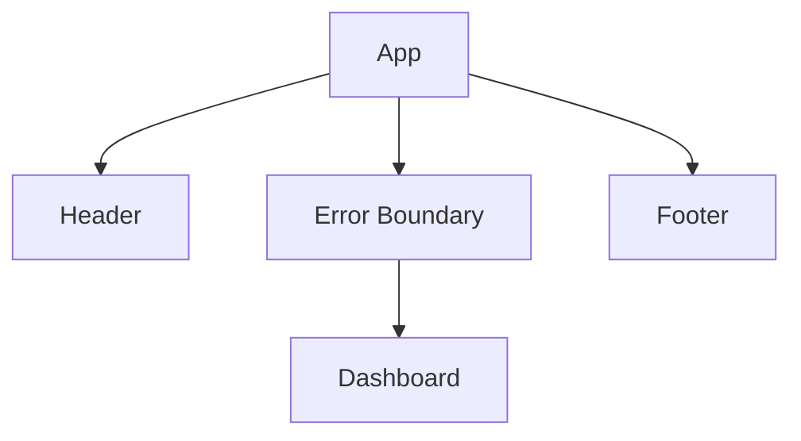

# Unidad 26: Errores y Error Boundaries

[Volver al índice del curso](../README.md) · [Ver el curso en Aprende con Leli](https://lelyliliana.github.io/aprende-con-leli/cursos/react/)

## Qué aprenderás
Distinguir errores de render, eventos y asincronía y aislar fallos de subárboles.

## 1. Boundary

Un Error Boundary puede capturar ciertos errores lanzados durante render/lifecycle de descendientes y mostrar fallback.

No captura universalmente:

- errores en event handlers;
- errores async arbitrarios;
- errores del propio boundary;
- errores fuera de su subárbol.

## 2. Alcance



Si Dashboard falla, puedes preservar el resto.

## 3. Granularidad

Un boundary en toda la app evita pantalla completamente rota, pero un widget no debería necesariamente derribar toda la página.

Coloca límites según independencia de experiencia.

## 4. Fallback

Debe explicar:

- qué parte falló;
- qué puede hacer la persona;
- retry/reload cuando sea razonable.

No muestres stack trace.

## 5. Logging

El boundary puede reportar detalle técnico a observabilidad.

No incluyas datos sensibles.

## 6. Eventos

```jsx
async function handleSave() {
  try {
    await guardar();
  } catch (error) {
    setError(error.message);
  }
}
```

Un boundary no sustituye manejo de errores de una acción.

## 7. Async data

Errores de fetch normalmente se modelan como estado de datos/error de flujo, salvo que una librería/framework los integre explícitamente con boundaries.

APIs de acciones/transiciones pueden integrar errores con un boundary según su contrato. Esa integración explícita no convierte al boundary en capturador de toda Promise o evento arbitrario.

## 8. Suspense

Suspense y mecanismos modernos de datos pueden interactuar con boundaries según framework/librería.

No confundas “loading boundary” con error boundary.

## 9. Práctica guiada

Haz fallar un widget durante render y comprueba que Header/Footer sobreviven.

Después provoca fallo en click y observa que requiere manejo distinto.

## 10. Errores frecuentes

- boundary captura todo;
- boundary único global;
- stack al usuario;
- fetch error esperado como crash;
- event error sin try/catch/estado.

## 11. Reto
Dashboard con boundary por widget y fallback recuperable.

## 12. Autoevaluación

1. ¿Boundary captura eventos?
2. ¿Fetch esperado?
3. ¿Dónde colocarlo?
4. ¿Qué mostrar?
5. ¿Logging qué evita?
6. ¿Suspense = error boundary?

## 13. Checklist

- [ ] Clasifico errores.
- [ ] Aíslo subárboles.
- [ ] Fallback útil.
- [ ] Manejo eventos aparte.

Continúa con debugging.

## Laboratorio desarrollado: Errores de render y de acciones

### Modelo, contrato y decisiones

Widget lanza un error deliberado durante render. El boundary presenta un fallback y conserva el contenido externo. Reintentar cambia identidad del boundary y elimina la condición que provocaba el fallo. Un handler fallido requiere su propio manejo; no debes asumir que cualquier error asíncrono o evento se captura en el boundary. Suspense muestra espera de ciertos recursos compatibles, no es un reemplazo de estado loading para un fetch arbitrario en useEffect.

Un componente correcto conserva su contrato cuando cambian entradas y condiciones. Antes de añadir una optimización o una abstracción, identifica qué dato tiene propietario, qué resultado se deriva y qué efecto toca un recurso externo. En este laboratorio puedes observar esas decisiones y comparar una modificación concreta con la referencia.

### Preparar y abrir

Sigue [ENTORNO.md](../docs/ENTORNO.md) desde la raíz del curso. Después abre http://127.0.0.1:5173/#/laboratorio/26. El [archivo App.jsx](ejemplo/App.jsx) es el componente completo de la unidad. GitHub muestra código fuente: para interactuar necesitas la copia local y el servidor Vite.

No hace falta un proyecto npm distinto por unidad. El [índice de laboratorios](../src/App.jsx) carga este componente y conserva la navegación. Los estilos y la entrada comunes están en src. Si lo copias a otro proyecto, conserva los imports que use y el contexto de router cuando corresponda; un fragmento aislado no incluye automáticamente esas dependencias.

### Resultado esperado

El widget falla y se recupera; el contenido externo permanece.

### Implementación completa del componente

```jsx
import { useState } from "react";
import LimiteError from "../../components/LimiteError.jsx";
function Widget({ fallar }) {
  if (fallar) throw new Error("Fallo deliberado del laboratorio");
  return <p>Widget operativo.</p>;
}
export default function App() {
  const [fallar, setFallar] = useState(false),
    [revision, setRevision] = useState(0),
    [errorEvento, setErrorEvento] = useState("");
  function reiniciar() {
    setFallar(false);
    setRevision((n) => n + 1);
  }
  return (
    <section>
      <h2>Aislar un fallo de render</h2>
      <p>Contenido externo preservado.</p>
      <button type="button" onClick={() => setFallar(true)}>
        Provocar fallo de render
      </button>
      <LimiteError key={revision} onReintentar={reiniciar}>
        <Widget fallar={fallar} />
      </LimiteError>
      <button
        type="button"
        onClick={() => {
          try {
            throw new Error("Fallo de acción");
          } catch (error) {
            setErrorEvento(error.message);
          }
        }}
      >
        Provocar fallo de evento
      </button>
      <p role="alert">{errorEvento}</p>
    </section>
  );
}
```

Lee primero los imports, después el estado/valores derivados y al final los handlers y JSX. Los cambios de estado solicitan otro render: no cambian el snapshot ya capturado por un handler. En componentes que importan una feature, abre el archivo importado para seguir su contrato; no confundas un wrapper visual con toda la lógica del flujo.

### Experimentar y comprobar

Activa ambos fallos y documenta dónde se capturan. Cambia el widget para fallar siempre y explica por qué un reintento sin corregir la causa no basta.

**Casos que debes registrar:** Render fallido; encabezado preservado; reintento; evento manejado; causa persistente.

Escribe la predicción antes de modificar. Cambia una condición por vez y contrasta el resultado visible con sus datos de entrada. Console y Network aportan diagnóstico, pero una ausencia de excepciones no prueba por sí sola que la regla o la interacción sean correctas. Restaura las variantes defectuosas antes de continuar.

### Actividad y solución

Realiza [PRACTICA.md](PRACTICA.md) y consulta después [SOLUCIONES.md](SOLUCIONES.md). La solución explica qué decisión conserva el contrato; no exige copiar exactamente los mismos nombres. Cuando haya controles, recórrelos también con teclado y verifica que un error no elimine la posibilidad de corregirlo.

---

## Continuar el curso

- **Unidad anterior:** [Unidad 25: Pruebas de flujos asíncronos](../unidad25-pruebas-flujos/README.md)
- **Volver al índice:** [Todas las unidades](../README.md)
- **Siguiente unidad:** [Unidad 27: React DevTools y depuración](../unidad27-debug/README.md)

---

### ¿Necesitas apoyo con este tema?

Si te bloqueaste con la práctica, necesitas revisar tu entorno o adaptar lo aprendido a tu proyecto, podemos trabajarlo en una sesión personalizada.

[**Solicitar asesoría para este tema por WhatsApp**](https://wa.me/573103618296?text=Hola%2C%20Leli.%20Estoy%20estudiando%20Unidad%2026%20%E2%80%94%20Errores%20y%20boundaries%20del%20curso%20React%20%28https%3A%2F%2Fgithub.com%2Flelyliliana%2FCurso-React%2Ftree%2Fmain%2Funidad26-errores%29%20y%20necesito%20una%20asesor%C3%ADa%20personalizada.%20Mi%20duda%20es%E2%80%A6)
